# 僵尸新版概念美术需求

来源：指定飞书表格第 13–25 行的名称、系别、体型；玩法核对本工程 docs/僵尸类别与形象总表-20260923.md、hunt/simulation.ts、lib/hunt-save.ts 与 lib/ammo-carrier.ts。

本轮制作概念图，不替换游戏图集。表格黑金僵尸按已有备注改为金币造型；当前代码仍结算库存弹药，两者明确区分。

## 0. 普通僵尸

【无｜小体型】
玩法依据：基础游荡目标；普通命中 40% 击杀，×1 基础收益 10 核心。
新版美术需求：约 2.7 头身，小体型、窄肩短腿、松垮驼背。灰豆绿皮肤，稀疏三撮深发，不对称大眼、单颗缺牙；破旧青灰连帽背心、棕短裤和厚底旧鞋。无武器、无能量装置，靠下垂双臂与拖步识别基础感染者。
统一风格：参考图同款 Q 版 3D 手办质感，大眼、块面简洁、哑光材质、柔和棚灯，无血腥。概念图含主视角、侧面、背面；后续动画需独立制作。

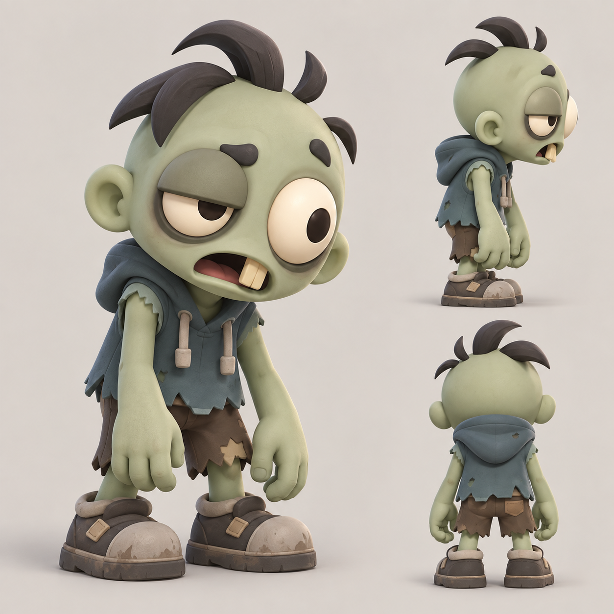

## 1. 奔跑者

【血肉系｜小体型】
玩法依据：高速穿场，速度 44；普通命中 20% 击杀，×1 基础收益 25 核心。
新版美术需求：小体型、收腰前倾、长小腿和夸张弹性跟腱，生物肌肉线条清晰但无裸露血肉。灰绿皮肤、短刺发，朱红运动头带与短围巾，破红白田径背心、护膝、轻便跑鞋。奔跑时手肘后摆，轮廓细长锐利，与普通僵尸的拖步区分。
统一风格：参考图同款 Q 版 3D 手办质感，大眼、块面简洁、哑光材质、柔和棚灯，无血腥。概念图含主视角、侧面、背面；后续动画需独立制作。

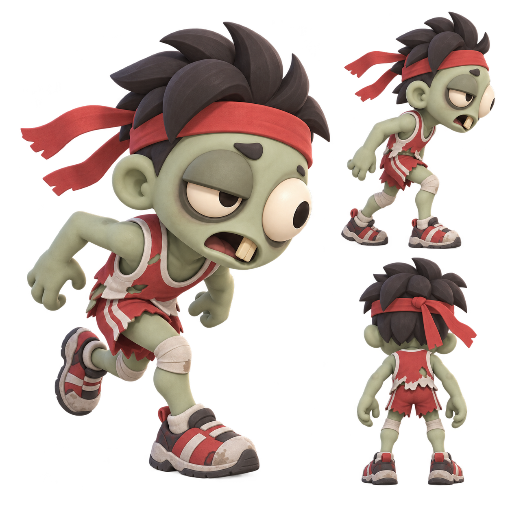

## 2. 装甲僵尸

【机器系｜小体型】
玩法依据：低速耐打；普通命中 8% 击杀，×1 基础收益 80 核心。
新版美术需求：小体型方块轮廓，头大腿短。感染者半张灰绿脸露在一体式防暴桶盔下，另一半为红色机械目镜；石墨灰与蓝灰分块护甲，粗铆钉、外露肘部铰链、宽小腿护板。双臂为空手机械护臂，不携枪，不做大型保险柜轮廓。
统一风格：参考图同款 Q 版 3D 手办质感，大眼、块面简洁、哑光材质、柔和棚灯，无血腥。概念图含主视角、侧面、背面；后续动画需独立制作。

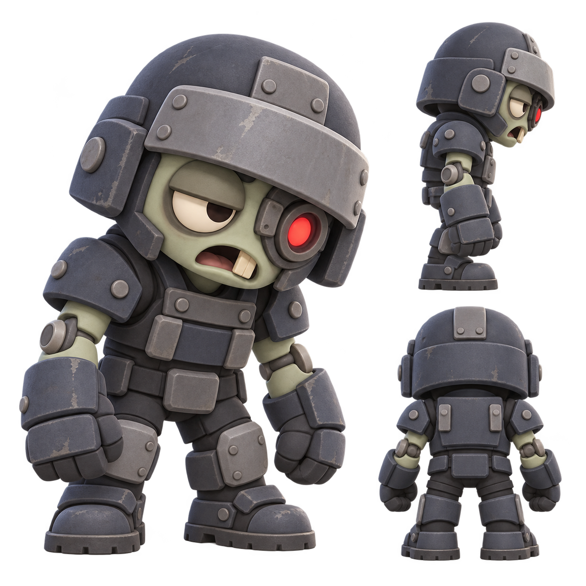

## 3. 巨型僵尸

【血肉系｜大体型】
玩法依据：低速巨型目标，速度 13；普通命中 2% 击杀，×1 基础收益 400 核心。
新版美术需求：大体型，体高约普通的 1.6 倍、肩宽约 2.2 倍；小脑袋陷在梯形肩背中，左右巨臂下垂至膝盖。暖灰绿皮肤、完整皮肤上的圆鼓变异肌肉，砖红色皮下纹路，破黑背带与深棕裤，腕部旧束缚带。靠肉体重量呈现压迫，不穿机器重甲。
统一风格：参考图同款 Q 版 3D 手办质感，大眼、块面简洁、哑光材质、柔和棚灯，无血腥。概念图含主视角、侧面、背面；后续动画需独立制作。

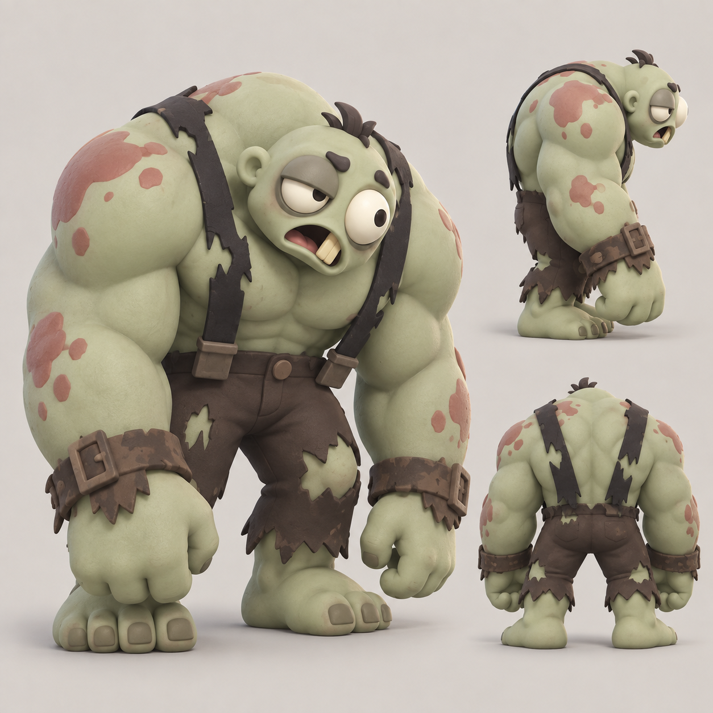

## 4. 奖励僵尸

【血肉系｜小体型】
玩法依据：击杀开启 15 秒奖励时间，最多 100 发免费奖励弹；×1 基础收益 50 核心。
新版美术需求：小体型圆肚矮胖、短腿快倒步，灰绿皮肤与红色鼻尖。披旧酒红舞台短斗篷，布质奖章绶带，背一只软布庆典补给包；包顶是扇形金黄色赠券和夸张沙漏徽记。击破时赠券、暖金星屑与倒计时反馈，表达限时奖励；不用金币或黑金弹箱。
统一风格：参考图同款 Q 版 3D 手办质感，大眼、块面简洁、哑光材质、柔和棚灯，无血腥。概念图含主视角、侧面、背面；后续动画需独立制作。

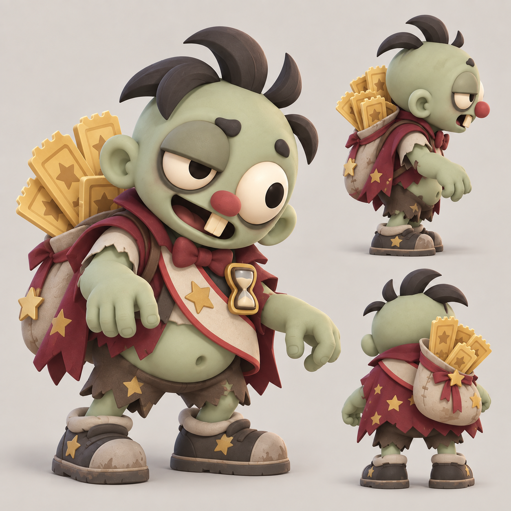

## 5. 爆炸僵尸

【元素系｜小体型】
玩法依据：击杀触发半径 155 的范围爆炸，每个范围目标最多尝试 3 次命中；×1 基础收益 100 核心。
新版美术需求：小体型梨形鼓腹，炭灰色完整岩壳皮肤、橙红熔火裂纹；头顶一簇圆钝火苗，背部长一团圆鼓火山囊，囊口呈粗短火山口。仅保留烧焦工装腰带和短裤。受击蓄热、击破向外爆出火环；不用燃油桶、引线炸药或机械罐。
统一风格：参考图同款 Q 版 3D 手办质感，大眼、块面简洁、哑光材质、柔和棚灯，无血腥。概念图含主视角、侧面、背面；后续动画需独立制作。

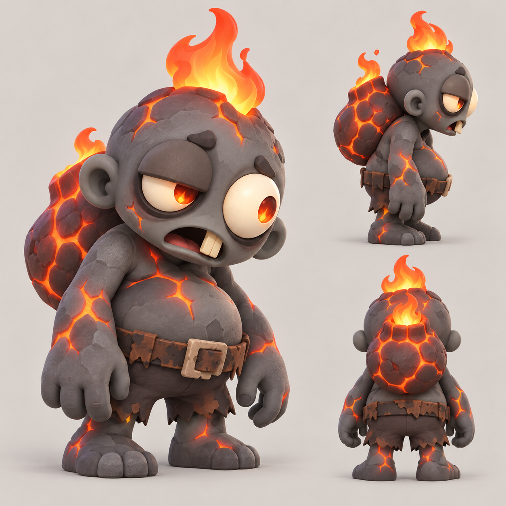

## 6. 散射僵尸

【机器系｜小体型】
玩法依据：累计 6 次有效命中击杀；实体子弹命中时产生 5 枚散射弹，×1 基础收益 120 核心。
新版美术需求：小体型机械刺猬轮廓，低矮灰绿感染者套深紫机壳，背部五根短粗导流管呈放射扇形展开。胸口六枚清楚可数的装甲触点，橙色回弹缓冲器。双手空着；弹片向外分流，不使用手持霰弹枪，避免与散弹工程僵尸混淆。
统一风格：参考图同款 Q 版 3D 手办质感，大眼、块面简洁、哑光材质、柔和棚灯，无血腥。概念图含主视角、侧面、背面；后续动画需独立制作。

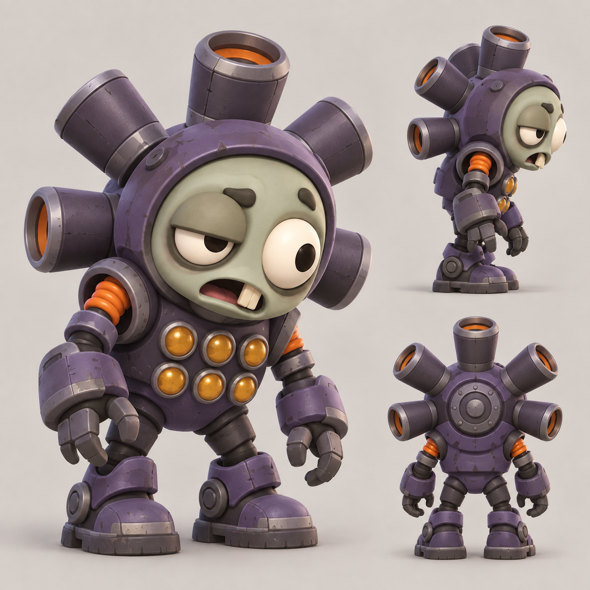

## 7. 电弧僵尸

【元素系｜小体型】
玩法依据：击杀后在半径 230 内连锁最多 4 个目标，各最多尝试 2 次命中；×1 基础收益 120 核心。
新版美术需求：小体型清瘦、重心略悬，青灰皮肤有淡金雷纹；头发形成四束圆钝闪电尖，背后四枚浮空雷晶分布如不闭合光环。深靛破短袍、赤足，前臂有细小分叉电弧。表现觉醒雷元素，不放线圈、电池、天线或机械装甲。
统一风格：参考图同款 Q 版 3D 手办质感，大眼、块面简洁、哑光材质、柔和棚灯，无血腥。概念图含主视角、侧面、背面；后续动画需独立制作。

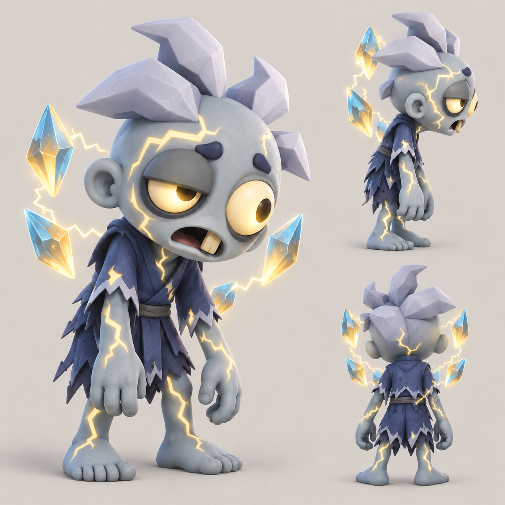

## 8. 冰冻僵尸

【元素系｜小体型】
玩法依据：击杀后冻结半径 175 内目标 4 秒；×1 基础收益 90 核心。
新版美术需求：小体型圆头收肩，霜蓝皮肤，白色冰霜短发；左右肩生出宽大的六角冰晶，背部扇形冰片呈雪花轮廓，深蓝破短披肩和毛边靴。动作僵硬、呼出冷雾，击破铺开环形霜纹。冰晶形大面简洁，不用冷却罐或管道。
统一风格：参考图同款 Q 版 3D 手办质感，大眼、块面简洁、哑光材质、柔和棚灯，无血腥。概念图含主视角、侧面、背面；后续动画需独立制作。

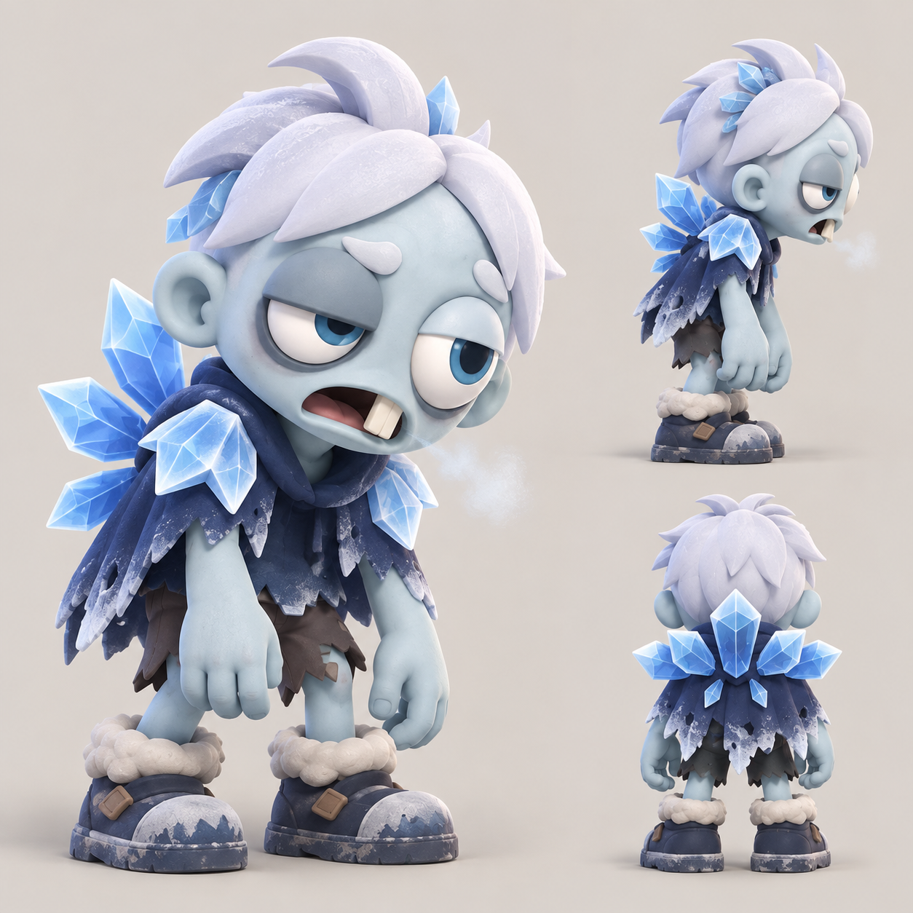

## 9. 装甲运钞僵尸

【机器系｜大体型】
玩法依据：每实际消耗 1000 黑金弹获得挑战资格；三层护甲各承受 6 次命中，击破后完成击杀获得橙色英雄。
新版美术需求：大体型移动保险柜，体高约普通的 1.8 倍，肩宽约 2 倍；黑铁厚甲与铜橙包角，极小灰绿僵尸头缩在防护领中。胸前三块可独立破碎的大护甲，背嵌厚重封闭保险柜，中心橙色英雄剪影徽记，粗液压腿。不给外露金币堆，区别于小型黑金僵尸。
统一风格：参考图同款 Q 版 3D 手办质感，大眼、块面简洁、哑光材质、柔和棚灯，无血腥。概念图含主视角、侧面、背面；后续动画需独立制作。

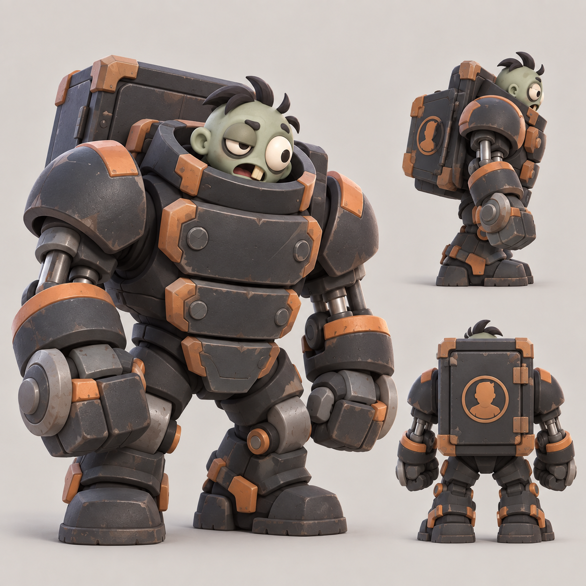

## 10. 棱镜工程僵尸

【机器系｜中体型】
玩法依据：击杀获得一次激光技能，手动启用后持续 20 秒；×1 基础收益 100 核心。
新版美术需求：中体型、身高约普通的 1.25 倍，瘦长上身。灰绿脸、青色光学护目镜、白灰短工程外套与石墨机械臂；背部竖直菱形棱镜模组，手持单孔方头激光器，青白光沿镜面折射。识别点为菱形镜与单束光，不画魔法闪电。
统一风格：参考图同款 Q 版 3D 手办质感，大眼、块面简洁、哑光材质、柔和棚灯，无血腥。概念图含主视角、侧面、背面；后续动画需独立制作。

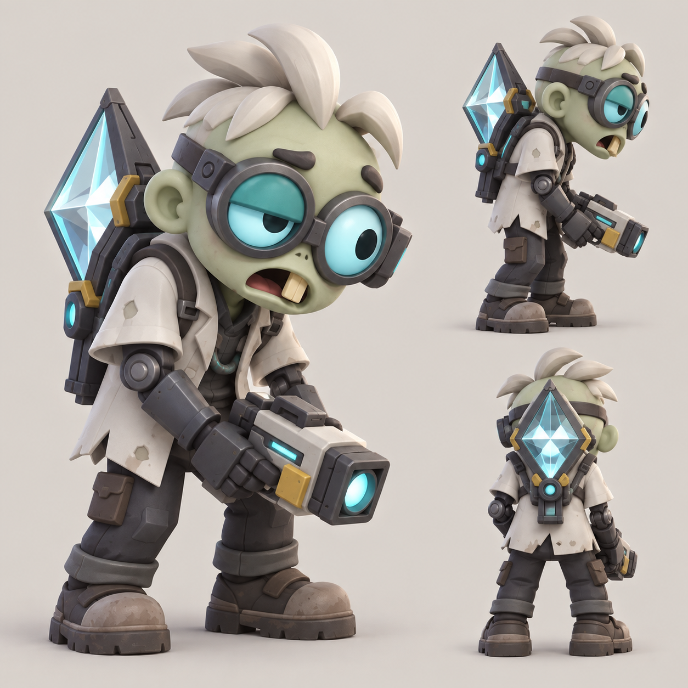

## 11. 散弹工程僵尸

【机器系｜中体型】
玩法依据：击杀获得一次散弹技能，手动启用后持续 20 秒；一次射击产生 7 枚弹片，×1 基础收益 100 核心。
新版美术需求：中体型、身高约普通的 1.25 倍，横向宽肩、结实机械前臂。灰绿脸、橙色焊工护目镜翻起，炭黑短工装、橙铜肩甲、粗弹带；抱双管短霰弹发射器，背挂矩形弹匣包。横向双圆枪口与前抱枪姿为核心，背上不放五向管阵。
统一风格：参考图同款 Q 版 3D 手办质感，大眼、块面简洁、哑光材质、柔和棚灯，无血腥。概念图含主视角、侧面、背面；后续动画需独立制作。

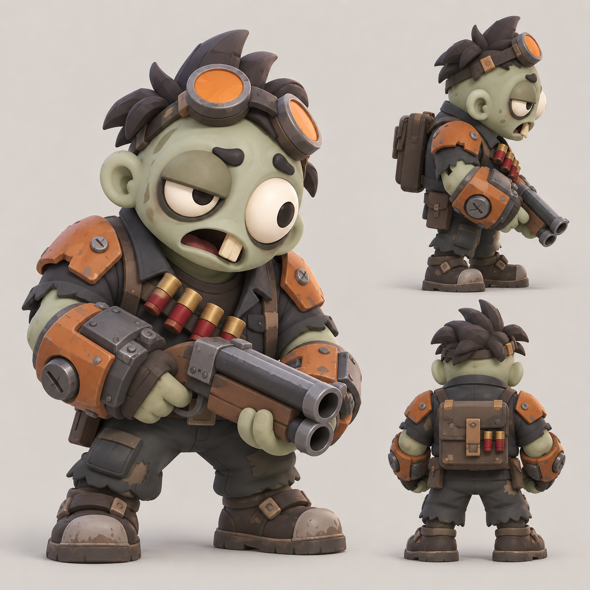

## 12. 黑金僵尸

【机器系｜小体型】
玩法依据：现代码：每倍率累计实际消耗 100 枪获得资格，3 次不同射击命中后返还出场时固定的 20×资格倍率库存弹药；在场可切倍率。本次依表格要求以黑金币表现补给，尚不改变游戏货币结算。
新版美术需求：小体型弓背搬运机，灰绿僵尸脸配单边金色机械目镜，灰黑工装和细小关节；背部宽方形黑铁开口钱匣、金色包角，露出三摞大号黑金币。金币必须是扁圆盘、黑色币面、金色厚币边和简洁压印，绝不画弹头。胸前挂三枚金色箱扣，表示三次击破；币片从箱中飞向库存。
统一风格：参考图同款 Q 版 3D 手办质感，大眼、块面简洁、哑光材质、柔和棚灯，无血腥。概念图含主视角、侧面、背面；后续动画需独立制作。

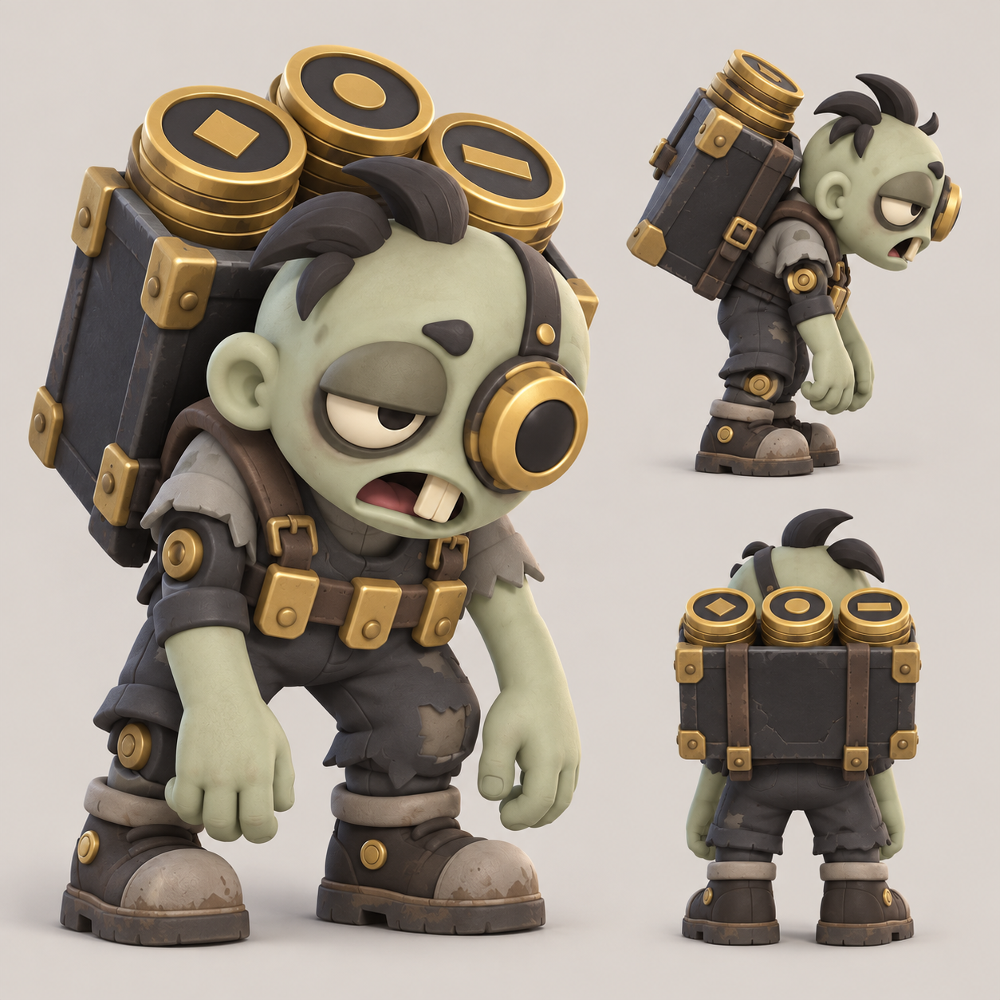